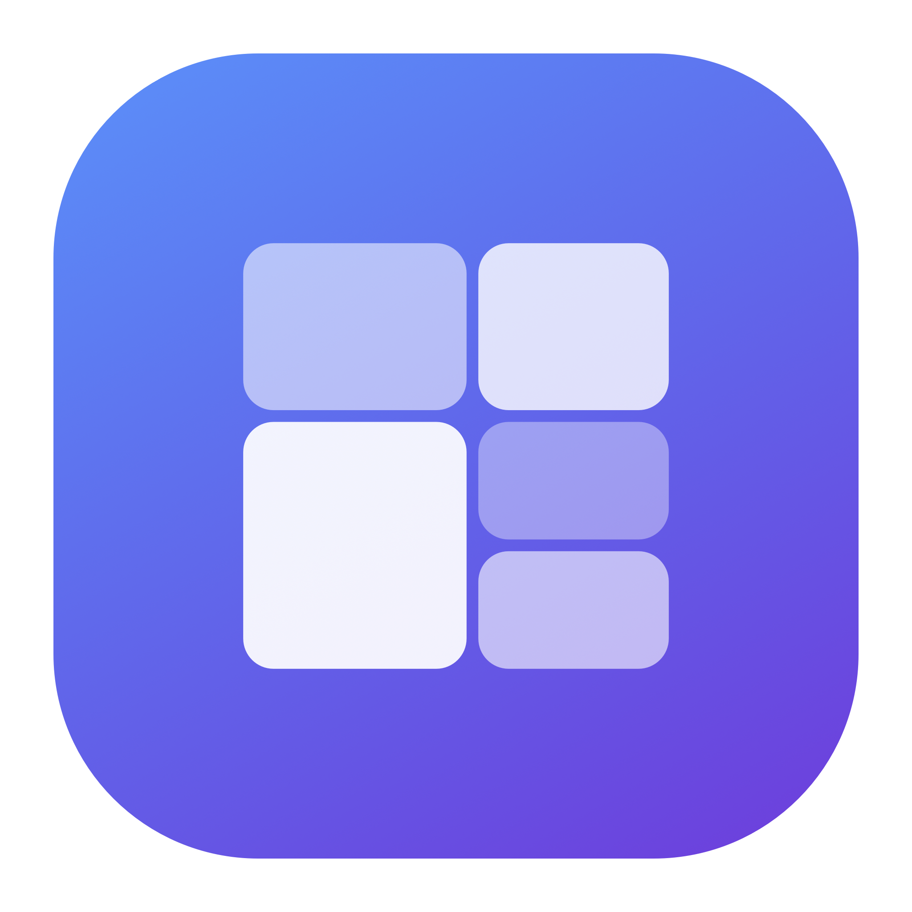
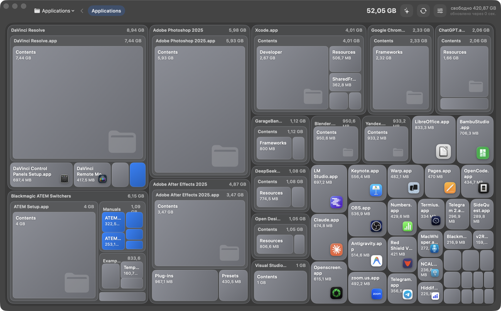
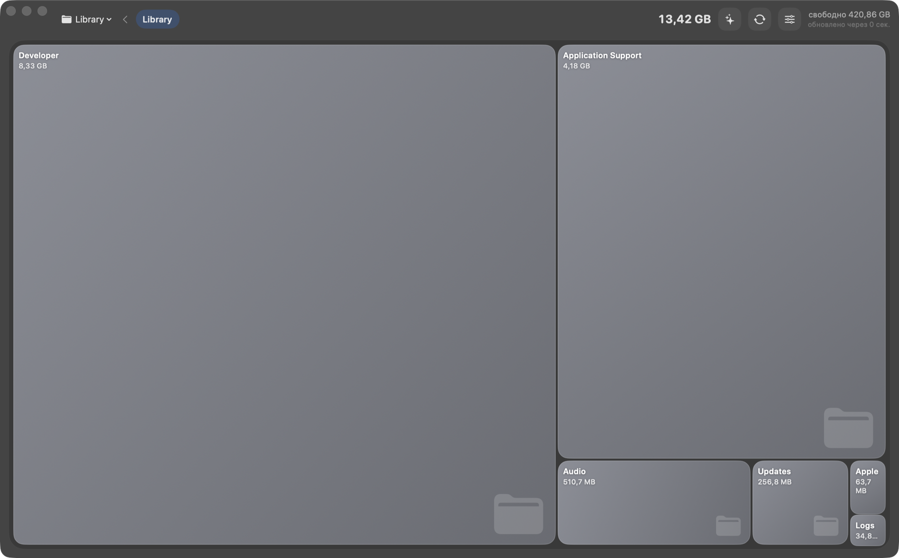

<p align="center"></p>

<h1 align="center">Space Lens</h1>

<p align="center">Красивая карта занятого места на Mac: папки и файлы квадратами, как в SpaceSniffer, но в стиле iOS.<br>
Быстро открыть, найти, удалить — безопасно, только через Корзину. С режимом ИИ-агента.</p>

<p align="center"></p>

## Скачать

**[Последний релиз → Releases](../../releases/latest)** — скачайте `SpaceLens-*.dmg`, откройте и перетащите **Space Lens** в «Программы».

Требуется macOS 14 или новее (Apple Silicon).

> **Первый запуск.** Приложение пока не нотаризовано Apple, поэтому macOS может написать, что оно от неустановленного разработчика.
> Откройте его через правый клик → «Открыть». Если macOS пишет «повреждено», выполните один раз:
> ```bash
> xattr -dr com.apple.quarantine "/Applications/Space Lens.app"
> ```
> Для полного обхода диска дайте приложению «Полный доступ к диску» (Системные настройки → Конфиденциальность), тогда macOS не будет переспрашивать доступ к каждой папке.

## Что умеет

- **Карта в реальном времени.** Квадраты растут прямо во время сканирования. Размер плитки — размер папки или файла.
- **Индекс.** Результат сохраняется на диск, повторный запуск открывается мгновенно. Данные моложе часа считаются свежими, старые дообновляются только там, где что-то изменилось. Кнопка ↻ делает полную пересинхронизацию.
- **Вложенность по желанию.** В настройках можно показывать только текущий уровень.
- **Цвета.** Папки и файлы разного цвета (по умолчанию серые папки и синие файлы), палитра настраивается.
- **Настоящие иконки** приложений и папок с пользовательской иконкой.
- **Быстрые действия.** Двойной клик — зайти внутрь, правый клик — показать в Finder, открыть, скопировать путь, в Корзину.

<p align="center"></p>

## Безопасность

- Удаление **только** через «Корзину» (`trashItem`), всё можно вернуть кнопкой «Отменить».
- Перед удалением путь перепроверяется заново, системные и защищённые места удалить нельзя.
- Для потенциально важного нужно явное подтверждение.
- ИИ никогда не делает что-то «безопасным» сам и не снимает локальную защиту.

## Режим ИИ

Кнопка ✨ в верхней панели: окно остаётся тем же, но карта показывает рекомендации агента для текущей папки.

- 🔴 красный — можно удалить, 🟡 жёлтый — удалять с осторожностью;
- значок ✨ в углу плитки открывает подсказку, почему это можно убрать и как восстановить.

Работает через найденные в системе CLI-агенты (Claude Code, Codex, Gemini CLI) или через API-ключ (хранится в Keychain).

## Сборка из исходников

Нужны Xcode Command Line Tools и Swift 5.9+.

```bash
./build.sh            # собрать build/Space Lens.app
./build.sh install    # собрать, поставить в /Applications и запустить
./release.sh          # собрать dist/SpaceLens-<версия>.dmg
```

Если в связке ключей есть сертификат Apple Development, приложение подписывается им — тогда разрешения macOS не сбрасываются после пересборки. Иначе используется временная подпись.

## English

Space Lens is a native macOS disk-usage treemap with an iOS-like look: live-building map, on-disk index for instant relaunch, trash-only safe deletion and an optional AI agent mode (Claude Code / Codex / Gemini CLI or an API key) that highlights what could probably be removed. Download the DMG from [Releases](../../releases/latest); build from source with `./build.sh`. macOS 14+, Apple Silicon.

## Лицензия

MIT
